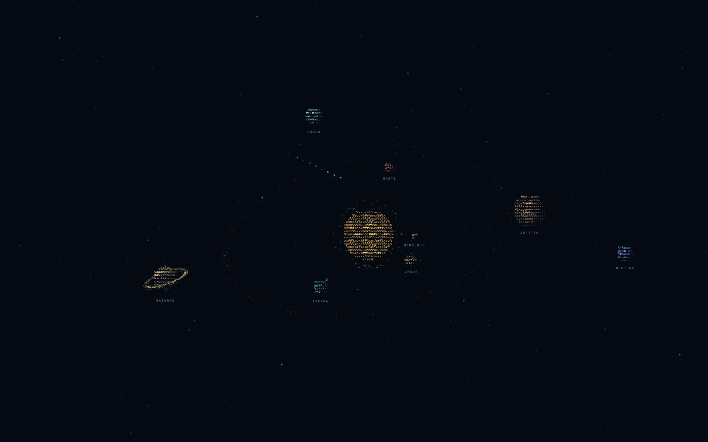

# Sistema solar ASCII

Fondo animado nativo para KDE Plasma 6: Sol, ocho planetas en órbita, Luna,
anillos de Saturno, estrellas titilantes, cinturón de asteroides y meteoritos.
Los tamaños y velocidades son artísticos. Sin sonido ni conexiones de red.



## Requisitos

- KDE Plasma 6; probado en Plasma 6.8.2 y Qt 6.12 sobre Wayland.
- Python 3, `qdbus6` y `kpackagetool6` para la instalación automática.
- DejaVu Sans Mono para las etiquetas y los caracteres del fondo.

## Instalar desde el código

```bash
git clone https://github.com/jaasieldelgado131/sistema-solar-ascii.git
cd sistema-solar-ascii
python3 manage.py install
```

Instala el paquete para tu usuario, guarda el fondo anterior y activa el sistema
solar en los escritorios de Plasma. No requiere permisos de administrador.
Plasma guarda la selección para el siguiente inicio de sesión.

También puedes descargar el paquete de [Releases](https://github.com/jaasieldelgado131/sistema-solar-ascii/releases/latest)
e instalarlo manualmente:

```bash
kpackagetool6 -t Plasma/Wallpaper -i sistema-solar-ascii.plasmapkg
```

Si ya estaba instalado, sustituye `-i` por `-u`. Después selecciónalo en los
ajustes del fondo de pantalla. El respaldo automático se crea con `manage.py install`.

## Personalizar y restaurar

Clic derecho en el escritorio → **Configurar el escritorio y el fondo de pantalla**
→ **Sistema solar ASCII**. Permite cambiar velocidad, FPS, estrellas, nombres y
pausa. El menú del escritorio también ofrece pausar/reanudar.

La animación se pausa al bloquear la sesión, con un margen de hasta tres segundos.
El ajuste inicial usa 30 FPS para las órbitas y 4 FPS para las texturas ASCII.
Los fotogramas de los planetas están precalculados para reducir el trabajo de CPU;
las órbitas se calculan en tiempo real.

```bash
python3 manage.py restore   # Recuperar la selección anterior de fondo
python3 manage.py status
```

La selección anterior queda en `~/.local/state/local.solar.ascii/previous-wallpaper.json`.

## Desarrollo

Node.js ejecuta las pruebas de geometría. La vista previa y las pruebas Qt
necesitan PySide6; regenerar sprites requiere Pillow y DejaVu Sans Mono.

```bash
node --test tests/scene.test.cjs
python3 -m unittest tests/test_native.py -v
python3 preview.py
python3 manage.py package
python3 tools/generate_sprites.py
```

Si actualizas QML que Plasma ya cargó, puede ser necesario recargar el escritorio
o volver a iniciar sesión para descartar su caché.

## Licencia

[MIT](LICENSE). Los sprites se generan con el código incluido.
