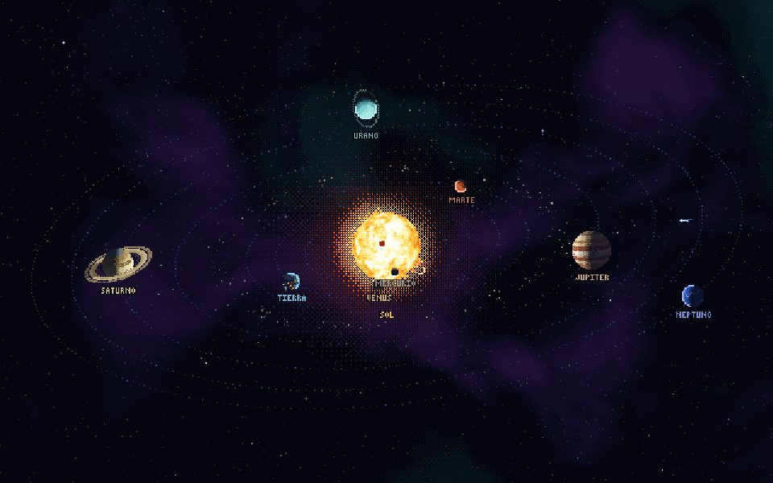

# Sistema solar pixel art

Fondo animado nativo para KDE Plasma 6, hermano del [sistema solar ASCII](../README.md).
Convive con él: los dos aparecen en los ajustes del fondo y puedes cambiar de uno a otro
cuando quieras.



## Qué tiene

- **Planetas que rotan y reciben la luz del Sol.** Cada planeta tiene 64 fases de
  rotación × 32 direcciones de luz. Los que pasan por delante del Sol se ven en
  cuarto creciente; los que están detrás, llenos.
- **La Tierra** con océanos, continentes, casquetes, nubes que se mueven más rápido que
  la superficie, luces de ciudades en el lado nocturno y un brillo del Sol sobre el mar.
  La Luna la orbita y se esconde detrás.
- **Júpiter** con bandas, la Gran Mancha Roja y sus cuatro lunas galileanas.
  **Saturno** con anillos (división de Cassini incluida) que proyectan sombra sobre el
  planeta y reciben la suya. Urano con su anillo casi vertical, Neptuno con su mancha oscura.
- **Sol animado:** granulación, manchas solares que giran, corona en *dithering* y
  protuberancias que suben y bajan.
- **Cometa** en órbita kepleriana: acelera al acercarse al Sol y su cola, azul y
  dorada, siempre apunta en sentido contrario.
- **Cinturón de asteroides**, estrellas que titilan, destellos de cuatro puntas,
  estrellas fugaces y una nebulosa de fondo.
- **Una nave** que viaja de la Tierra a Marte y regresa cada poco más de dos minutos.

Todo se dibuja a unos 640×400 píxeles de arte y se amplía sin suavizar, así que cada
píxel queda nítido. En 1920×1200 cada píxel de arte mide 3×3.

## Instalar

```bash
cd sistema-solar-ascii/pixel-art
python3 manage.py install
```

Instala el paquete para tu usuario (sin permisos de administrador), lo activa en todos
los escritorios, guarda tu fondo anterior y deja el comando `fondo-solar` en `~/.local/bin`.
Usa `--no-activate` para instalarlo sin cambiar el fondo.

## Cambiar de fondo

| Desde | Cómo |
| --- | --- |
| Terminal | `fondo-solar pixel`, `fondo-solar ascii`, `fondo-solar anterior`, `fondo-solar estado` |
| Escritorio | Clic derecho → **Cambiar al sistema solar ASCII** (también **Pausar/Reanudar**) |
| Ajustes | Clic derecho → **Configurar el escritorio y el fondo de pantalla** → **Sistema solar pixel art** |

`fondo-solar anterior` vuelve al fondo que tenías antes de los sistemas solares. El
respaldo queda en `~/.local/state/local.solar.pixel/previous-wallpaper.json` (si no existe,
usa el que creó la versión ASCII).

## Ajustes

Velocidad orbital, FPS (15/24/30/60), tamaño del píxel (automático, 2, 3 o 4), cantidad
de estrellas, nombres, órbitas punteadas, cometa/estrellas fugaces/nave, efecto CRT y pausa.
La animación se pausa al bloquear la sesión.

## Desarrollo

Los sprites se generan con `numpy` y Pillow; las pruebas Qt usan PySide6.

```bash
python3 tools/generate_pixel_art.py      # regenera contents/ui/art y Atlas.js
node --test tests/geometry.test.cjs
python3 -m unittest tests/test_native.py -v
python3 preview.py                       # ventana de vista previa
python3 preview.py --capture captura.png --time 36
python3 manage.py package                # sistema-solar-pixel.plasmapkg
python3 manage.py uninstall
```

Si actualizas QML que Plasma ya cargó, quizá debas reiniciar `plasmashell` o la sesión
para que descarte la caché.

## Créditos

Arte generado por código en este repositorio: esferas trazadas por rayos, ruido fractal
propio, paletas con desplazamiento de tono y *dithering* Bayer, técnicas habituales del
pixel art. Rotación de la nave al estilo RotSprite (Scale2x antes de rotar). Licencia [MIT](../LICENSE).
